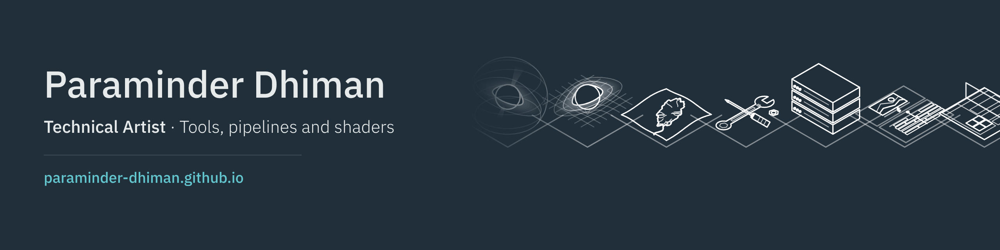

I'm a technical artist at Ubisoft, currently on Skull and Bones, where I build tools and pipelines in MaxScript and Python across 3ds Max, Houdini and the Anvil engine. The repos here are my personal projects: Blender extensions and real-time shaders.

**Blender**

- [Black Hole Studio](https://github.com/paraminder-dhiman/black-hole-studio) · renders a black hole by bending light the way general relativity does · Python, OSL · on [Blender Extensions](https://extensions.blender.org/add-ons/blackhole-studio/)
- [Unravel](https://github.com/paraminder-dhiman/unravel) · paint where cloth should tear, and it cuts, thickens and frays the holes · Geometry Nodes, Python · on [Blender Extensions](https://extensions.blender.org/add-ons/unravel/)
- [UV Island Colorizer](https://github.com/paraminder-dhiman/uv-island-colorizer) · gives every UV island its own colour and bakes a colour ID map · on [Blender Extensions](https://extensions.blender.org/add-ons/uv-island-colorizer/)
- [Positive Mirror](https://github.com/paraminder-dhiman/positive-mirror) · mirrors objects with a positive scale, so normals and exports stay correct

**Unreal Engine**

- [Black Hole Shader](https://github.com/paraminder-dhiman/black-hole-shader) · a real-time black hole material with a custom HLSL node · free on [Fab](https://www.fab.com/listings/a15ec3ff-d601-4c25-8338-f12082425b43)

How and why each one was built is on my portfolio · **[paraminder-dhiman.github.io](https://paraminder-dhiman.github.io)** · [LinkedIn](https://www.linkedin.com/in/paraminder-dhiman)
